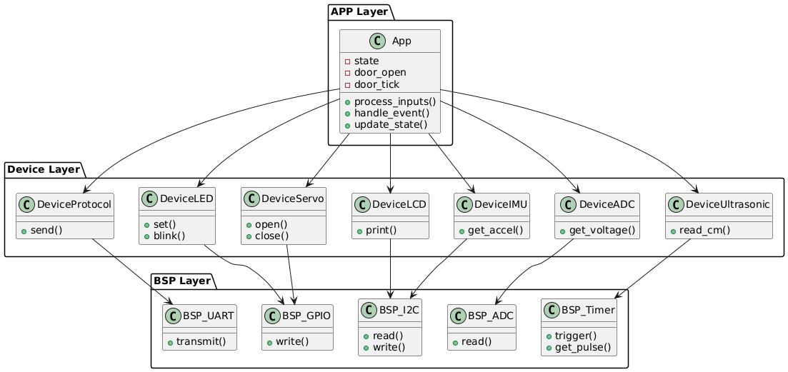
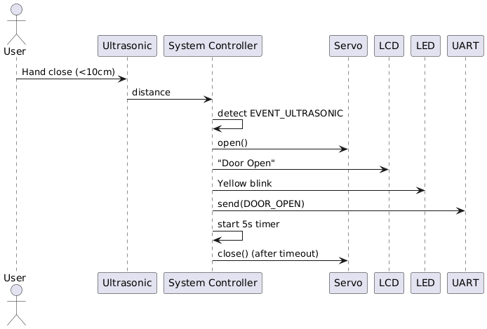
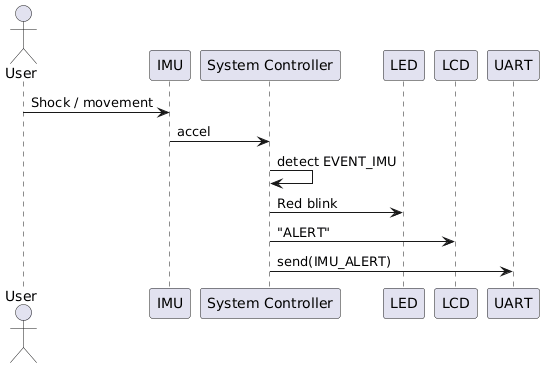
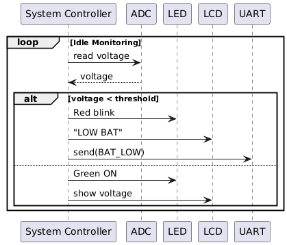

# STM32 Vehicle IoT Hands-On Project (Updated)

## Overview

This project demonstrates a layered embedded system architecture using STM32F4.
It integrates multiple peripherals (I2C, UART, PWM, TIMER, ADC) to build a simple
vehicle IoT system.

This version has been simplified to improve system stability and focus on core
event-driven behavior.

---

## System Overview

### System Architecture (Class Diagram)



---

## Sequence Diagrams

### 1. Door Open Flow (Ultrasonic)



---

### 2. IMU Alert Flow



---

### 3. Battery Monitoring Flow



---

## Target

- MCU: STM32F407VG
- Toolchain: arm-none-eabi-gcc
- Build: Makefile
- Architecture: app / devices / bsp

---

## Architecture

```
app/        → State machine, event handling
devices/    → Sensor/actuator abstraction
bsp/        → HAL wrapper
common/     → shared definitions
```

### Rules

- APP → devices only
- devices → bsp only
- bsp → HAL only

---

## Features

### 1. Idle State

- Green LED ON
- LCD displays battery voltage (ADC)

---

### 2. Door Control (Ultrasonic)

- Distance < 10 cm triggers door open
- Servo motor opens the door
- Yellow LED blinks
- LCD displays "Door Open"
- UART event is sent to host
- Door automatically closes after 5 seconds
- Door control is independent from system state

---

### 3. Vehicle Alert (IMU)

- Sudden acceleration triggers alert
- Red LED blinks
- LCD displays "ALERT!"
- UART alert event is sent

---

### 4. Battery Monitoring (ADC)

- Battery voltage continuously monitored in IDLE state
- If voltage < threshold:
  - Red LED blinks
  - LCD displays "LOW BAT"
  - UART warning sent periodically

---

## Key Components

### Ultrasonic (Timer Input Capture)

- Trigger: GPIO
- Echo: Timer capture
- Includes timeout-based recovery to prevent lock-up

---

### IMU (I2C)

- MPU6050
- Acceleration magnitude used for event detection

---

### ADC

- Battery voltage measurement
- Converted to real voltage using scaling

---

### Servo (PWM)

- Controls door open/close
- Operates independently from main state machine

---

## UART Protocol

Frame:

[0xAA][TYPE][DATA(4B)][CHECKSUM][0x55]

### TYPE

- 0x01 → Door Open
- 0x02 → IMU Alert
- 0x03 → Battery Low

---

## Design Notes

- Event-driven architecture
- State machine handles UI (LED/LCD)
- Actuator logic (e.g., door control) is separated from state
- Timeout-based recovery implemented for ultrasonic sensor
- Blocking code acceptable for PoC

---

## Limitations

- No event queue (possible event overwrite)
- No task separation (single loop execution)
- Limited scalability without RTOS

---

## Summary

This project demonstrates:

- Layered embedded system design
- Sensor integration
- Event-driven control
- Basic IoT communication
- Practical limitations of baremetal systems
